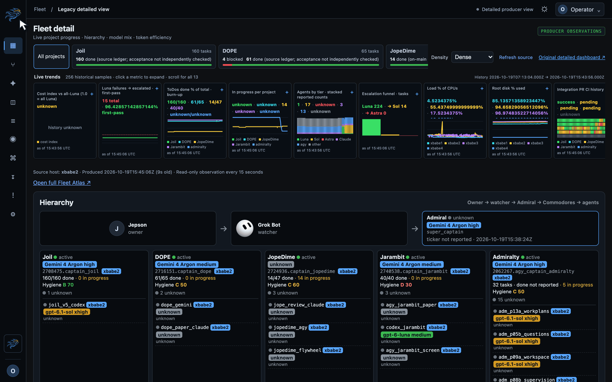
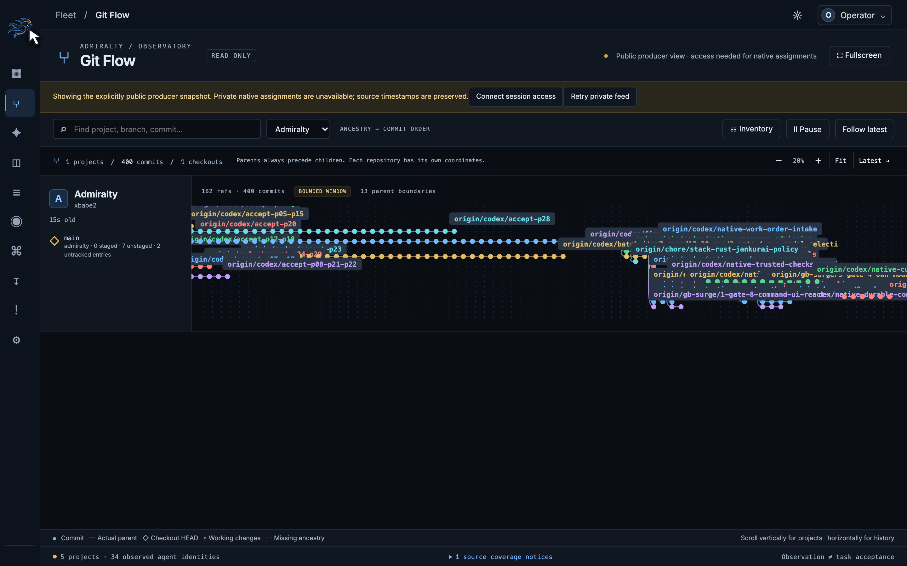
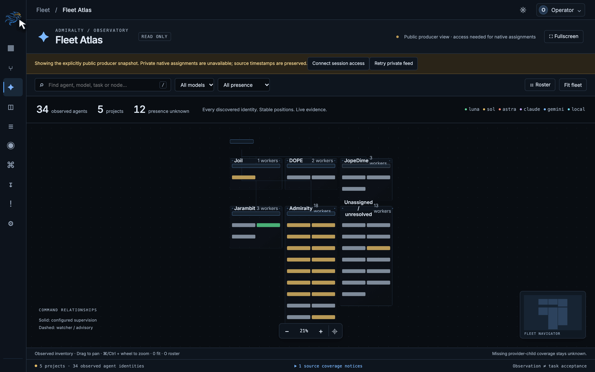

<p align="center">
  
</p>

# Admiralty

**A local-first fleet console and durable coordination toolkit for engineering work.**

Admiralty brings project observations, Git history, agent identities, task contracts and delivery evidence into one place. A Rust HTTP service and SQLite event store support a React, TypeScript and Vite console.

The operating model is **Owner → Admiral → Commodores → task workers**. The Admiral coordinates the fleet; each Commodore manages a project. Scoped messages and compact context capsules keep coordination separate from implementation work.

**Release status: source preview, version `0.1.0`.** The real-data dashboard, credential-free demo and scoped coordination tools are available. General managed coding execution and the full native major release are still under qualification. The [release checklist](docs/contributors/community-readiness.md) separates demonstrated behavior from remaining gates.

The [dashboard and routing qualification](receipts/integration/live-trends-display-20261020.json) records the local application matrix and mock trend coverage. The [atomic startup qualification](receipts/integration/atomic-store-startup-20261020.json) adds schema/replay rollback controls and measured Linux startup improvements. The [earlier bundle qualification](receipts/integration/community-release-startup-20261020.json) records Linux Store/signal tests and a real macOS private release-bundle round trip at its stated revision. Exact source revisions and platform limits are explicit.

[Quickstart](#quickstart) · [Production walkthroughs](#see-the-production-console) · [Documentation](#documentation) · [Contributing](CONTRIBUTING.md) · [Security](SECURITY.md) · [MIT License](LICENSE)

## Quickstart

Prerequisites: **Rust 1.95.0**, **Node 24**, **pnpm 11.15.1**, Bash and a native C build toolchain. Rust and pnpm versions are pinned in the repository. The first build may download dependencies and compiles both the dashboard and Rust service.

```sh
git clone https://github.com/neverhuman/admiralty.git
cd admiralty
pnpm install --frozen-lockfile --ignore-scripts
pnpm demo
```

Open [Demo overview](http://127.0.0.1:18892/#/overview), then explore **Workplans**. The demo uses synthetic projects and agents, with no provider accounts, credentials, machine enrollment or real project access. Stop it with **Ctrl-C**.

`ADMIRALTY_DEMO_LISTEN` selects another loopback address; `ADMIRALTY_TARGET_DIR` selects an alternative Cargo build directory. After dependencies are available, the demo runtime does not need a provider or external network service.

Inspect the binary's actual capabilities and CLI without starting a server:

```sh
cargo run -p admiralty-cli --locked -- doctor
cargo run -p admiralty-cli --locked -- demo --snapshot-only
cargo run -p admiralty-cli --locked -- --help
```

The current install path is a source build. There is no published, qualified binary release or supported one-command installer yet. See [platform support and release gates](docs/contributors/community-readiness.md#platform-support).

## See the production console

Real production observations, captured on **19 October 2026** at **2880 × 1800**. These short, edited walkthroughs use actual read-only clicks, with visible pointers and click rings. Source timestamps, unknown measurements and access boundaries stay visible. Modern browsers receive full-color lossless WebP; GIF fallbacks use an optimized 256-color palette. Reduced-motion readers receive still images.

### Fleet console — projects, history and evidence

Select Admiralty, expand task burn-up history, then scroll into observed worker models and project evidence. The hierarchy connects the Owner, watcher, Admiral and project Commodores.

<picture>
  <source media="(prefers-reduced-motion: reduce)" srcset="docs/demos/fleet-console.png" />
  <source type="image/webp" srcset="docs/demos/fleet-console.webp" />
  
</picture>

[Lossless animation](docs/demos/fleet-console.webp) · [GIF](docs/demos/fleet-console.gif) · [Still image](docs/demos/fleet-console.png) · [Capture receipt](docs/demos/fleet-console.json)

### Git Flow — ancestry, checkouts and commits

Explore Admiralty's observed Git graph, fit ancestry, return to the latest frontier, and inspect an actual checkout and commit. Branch tips, working changes and bounded-history notices retain their source meanings.

<picture>
  <source media="(prefers-reduced-motion: reduce)" srcset="docs/demos/git-flow.png" />
  <source type="image/webp" srcset="docs/demos/git-flow.webp" />
  
</picture>

[Lossless animation](docs/demos/git-flow.webp) · [GIF](docs/demos/git-flow.gif) · [Still image](docs/demos/git-flow.png) · [Capture receipt](docs/demos/git-flow.json)

### Fleet Atlas — command relationships and agent flow

Move from the full fleet map into Joil's Commodore and worker relationship, inspect a reported worker model and source time, then open the complete agent roster. Configured roles and observed presence remain distinct.

<picture>
  <source media="(prefers-reduced-motion: reduce)" srcset="docs/demos/fleet-atlas.png" />
  <source type="image/webp" srcset="docs/demos/fleet-atlas.webp" />
  
</picture>

[Lossless animation](docs/demos/fleet-atlas.webp) · [GIF](docs/demos/fleet-atlas.gif) · [Still image](docs/demos/fleet-atlas.png) · [Capture receipt](docs/demos/fleet-atlas.json)

These captures use the deployment's explicitly public producer view. Private native assignments require session access. To refresh the recordings, use the [capture and compression guide](docs/operators/demo-capture.md); scripts preserve original PNGs locally and verify every lossless animation interval against its source pixels.

## What you can use today

- **Fleet observations:** configured project ledgers, task stages, Git/PR evidence, agent/model observations, resource measurements and thirteen temporal plots. Live measurements display at most two decimal places. Full totals and explicitly labeled observed samples remain distinct; missing measurements and original source times remain visible.
- **Git Flow and Fleet Atlas:** ancestry, branches, linked/detached checkouts, command relationships, searchable inventories and evidence inspectors. Requested model names, configured roles and observed processes retain distinct meanings.
- **Scoped native coordination:** durable typed captain–admiral messages, exact retries, own-inbox application receipts, task contracts and compact context through authenticated CLI/MCP and HTTP adapters.
- **Offline tools:** workplan previews and immutable revision registration, contract validation, backups and restore rehearsals. Release tools stage explicit inputs, create archives and install a new private version directory.

Task recording, routing proposals, a successful process or a green subset of checks does not establish executed or accepted work. Native coding-provider admission, trusted verification, settlement and restart recovery remain separate release gates; see [current qualification](docs/operators/release-status.md).

## Connect real observations

Configure the Rust observer for your own repositories and sources using the [native observer guide](docs/operators/native-observer.md) and [example configuration](configs/examples/observe.json). Replace the example identities and absolute paths with your own. The observer produces `status.json` and bounded history; it does not launch workers or change project repositories.

The convenience launcher connects an existing producer feed to the React console:

```sh
pnpm live \
  --status /absolute/path/status.json \
  --index "$PWD/dashboard/index.html"
```

Open [http://127.0.0.1:18891/](http://127.0.0.1:18891/). The original detailed HTML remains at `/legacy/`; **Git Flow** and **Fleet Atlas** use `#/git` and `#/atlas`. This launcher also needs **Python 3** to create protected preview state. Native HTTP serving and observation ingestion run in Rust.

The launcher prints the private access-token **file path**, never the token value. Use **Session access** for authenticated native data and model settings. This convenience mode explicitly enables public loopback reads of the existing detailed feed. Keep the listener on loopback and use an authenticated SSH tunnel for remote access.

`ADMIRALTY_LIVE_LISTEN` changes the loopback address; `ADMIRALTY_STATE_DIR` selects private preview state. The compatibility feed refreshes every 15 seconds; native changes use a shared authenticated event stream. Source age and unknown measurements are preserved.

For protected task intake and scoped agent access, follow [native startup](docs/operators/native-startup.md). It requires private, owned configuration and credential files and does not install a general provider executor. Model profiles are configured through [model policy](docs/operators/models.md); configured endpoints or model names alone do not establish working execution capacity.

## Documentation

| Goal | Guide |
| --- | --- |
| Understand current support and release readiness | [Community readiness](docs/contributors/community-readiness.md), [release status](docs/operators/release-status.md) |
| Collect and display real project data | [Native observer](docs/operators/native-observer.md), [live console](docs/operators/live-console.md) |
| Configure native access and typed role messages | [Native startup](docs/operators/native-startup.md), [native coordination](docs/operators/native-coordination.md) |
| Capture and enrich work orders | [Work-order intake](docs/operators/work-order-intake.md), [workplan import](docs/operators/workplan-import.md) |
| Configure model policies | [Models](docs/operators/models.md), [development routing](docs/operators/model-routing.md), [OpenCode SSH qualification](docs/operators/opencode-ssh.md) |
| Understand Git and agent views | [Live views](docs/operators/live-views.md) |
| Back up, rehearse recovery or install an explicit archive | [Recovery manifests](docs/operators/recovery-manifest.md), [native archive](docs/operators/native-archive.md), [private version installation](docs/operators/native-install.md) |
| Develop and reproduce checks | [Contributing](CONTRIBUTING.md), [local CI](docs/operators/local-ci.md) |
| Review architecture, evidence and remaining implementation | [Master plan](docs/plans/admiralty-v2/MASTER_PLAN.md), [execution ledger](docs/plans/admiralty-v2/EXECUTION.md), [remaining-work audit](docs/plans/admiralty-v2/REMAINING_20261019.md) |

The Rust crates contain domain contracts, Store, runtime, server, observer, CLI and integration tests. `apps/dashboard` contains the React application. `schemas` and `packages/contracts` hold the public contract pipeline. `dashboard`, `captains` and `tools` retain documented compatibility and fleet operating utilities.

## Develop and validate

Use the pinned toolchains above, **Python 3.12+** for retained compatibility tests, and an installed **Chrome or Chromium** for browser qualification. Then run:

```sh
pnpm check
```

This runs the complete local application matrix: frozen dependency installation, Rust formatting/Clippy/tests, compatibility and audit fixtures, package/canary checks, native binary builds and smoke, contracts, frontend unit tests/typechecks/build, and real browser/accessibility journeys. It does not invoke paid providers. Logs are retained in a private directory printed by the command. See [local CI](docs/operators/local-ci.md) for browser selection and build-cache overrides.

Linux-only checks and hosted CI are independent evidence; a local pass is not a full release or deployment claim. Keep one integration PR, preserve original failures and run checks before pushing. Read [CONTRIBUTING.md](CONTRIBUTING.md) before changing shared contracts or generated files.

## Security and license

Use the repository's [private vulnerability reporting channel](https://github.com/neverhuman/admiralty/security/advisories/new) for suspected security issues. Keep credentials, private configuration, real transcripts and exploit details out of public issues and commits. [SECURITY.md](SECURITY.md) describes the current trust boundaries and reporting process.

Admiralty is available under the [MIT License](LICENSE). Dependency and asset review remains part of the [distribution release gate](docs/contributors/community-readiness.md#major-release-gates).
