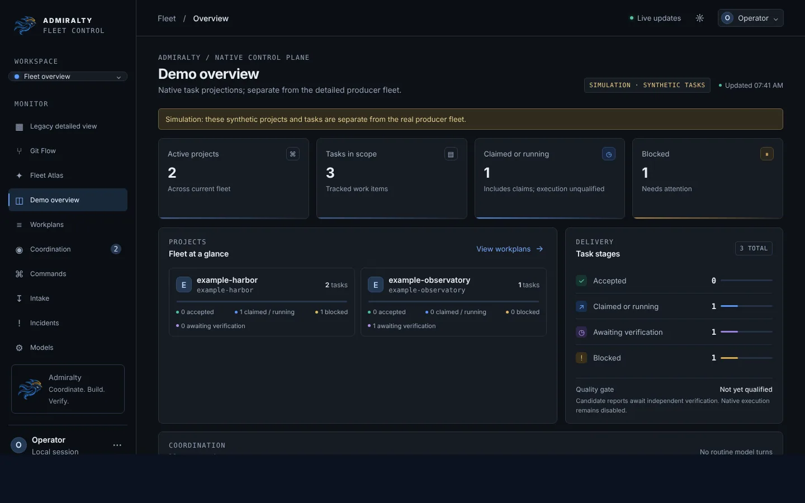
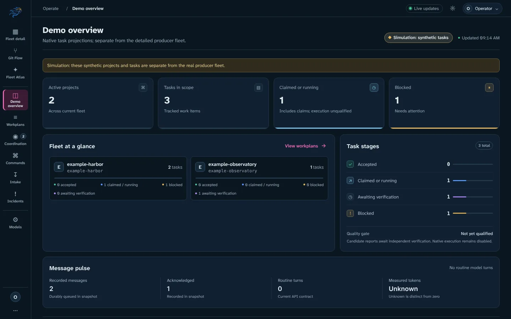
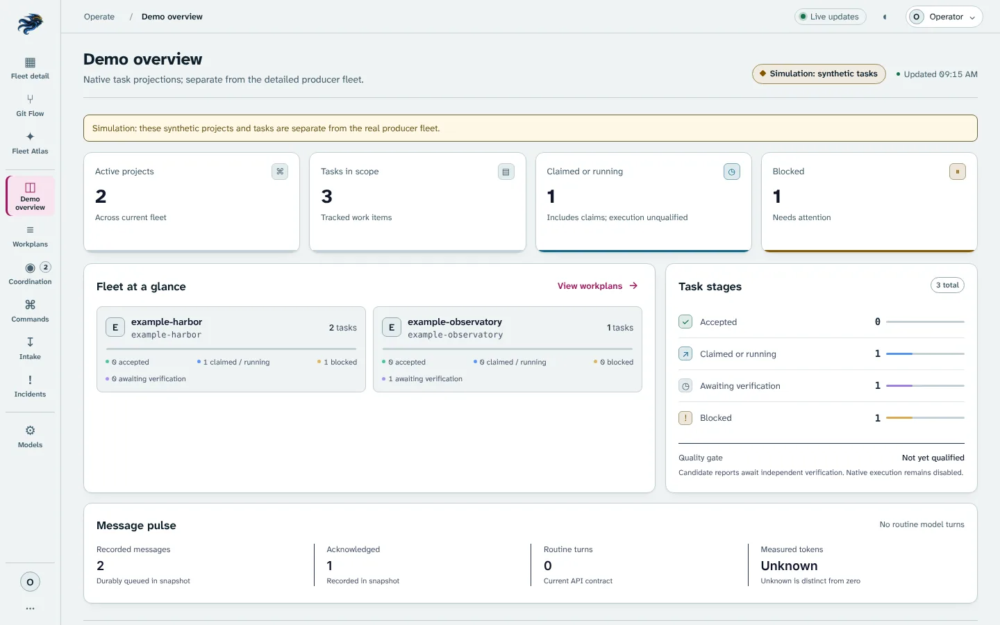
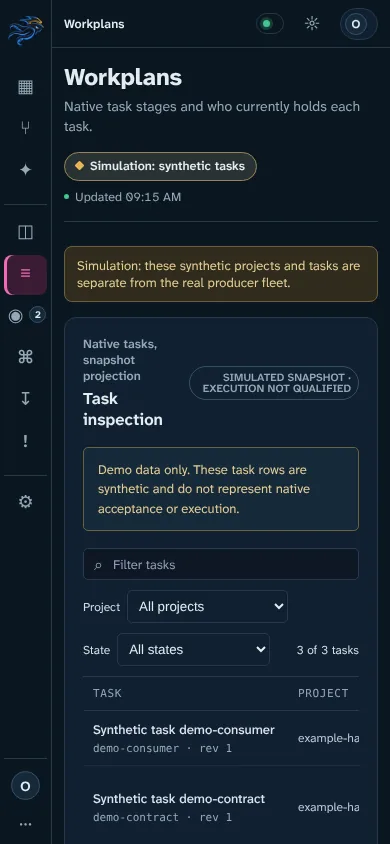

# Console design system

The React console uses one design system for every view, defined in
`apps/dashboard/src/ui/design-system.css` and loaded after the older
stylesheets. It replaces the three different shells that existed before
(a 244 px sidebar for native views, a 62 px icon rail for Fleet detail and a
64 px rail for Git Flow and Fleet Atlas) with one rail, one watch bar and one
token set.

## Before and after

The synthetic demo (`pnpm demo`), 1440 × 900:

| Before (`main` at `2f5b931`) | After, night watch |
| --- | --- |
|  |  |

| After, day chart | After, 390 px |
| --- | --- |
|  |  |

## Direction: the chart room

Admiralty's operating model is naval (Owner, Admiral, Commodores, workers), and
the console is where a watch-stander checks the fleet. The palette borrows from
printed nautical charts rather than from a generic dark dashboard:

| Token | Night watch (default) | Day chart | Use |
| --- | --- | --- | --- |
| `--ink` | `#0b1620` | `#eef3f3` | Page and rail background |
| `--hull` | `#102030` | `#ffffff` | Panels and cards |
| `--deck` | `#16293a` | `#e3ecee` | Raised and hover surfaces |
| `--rule` / `--rule-strong` | `#24394b` / `#34506a` | `#c3d1d6` / `#93a8b2` | Lines and control borders |
| `--chart-text` / `--chart-muted` | `#e3ecef` / `#93a9b6` | `#0f202b` / `#47606e` | Text |
| `--magenta` | `#ee6ab8` | `#a0175f` | Interaction: active view, focus, selection, links, primary actions |
| `--starboard` | `#43c48e` | `#15724a` | Healthy, passing |
| `--port` | `#ff7a7a` | `#b42330` | Failing |
| `--caution` | `#e8b65a` | `#835600` | Needs attention, simulation |
| `--sounding` | `#7cc3e8` | `#0e6888` | Neutral data series, in progress |

Charts print the marks a navigator must not miss in magenta, so magenta is
reserved for what the operator can act on. Nothing decorative uses it. Status
colours come from lateral buoys (starboard green, port red) and are always
paired with a word or a shape: the simulation pill uses a diamond, a live
connection a ringed dot, a failure a square. Colour never carries meaning
alone.

The older variable names (`--bg`, `--surface`, `--line`, `--text`, `--muted`,
`--blue`, `--gold`, `--green`, `--red`, `--lv-*`) are mapped onto these tokens,
so feature stylesheets pick up the palette without being rewritten.

## Type

- **Atkinson Hyperlegible Next** for the interface. It was designed by the
  Braille Institute for low-vision readers; its characters are deliberately
  distinct (0/O, 1/l/I, rn/m). An operator reading commit hashes, counts and
  model names at a glance benefits from that more than from a fashionable face.
- **Atkinson Hyperlegible Mono** only for identifiers: commits, refs, screens,
  paths, code.
- Both are self-hosted (`apps/dashboard/src/assets/fonts`, SIL OFL 1.1), so the
  console renders identically offline and inside the single binary.
- Scale on a 14 px base (minor third): 11, 12.5, 14, 16.5, 20, 24 px. Tabular
  numerals are on everywhere so counts align.
- Labels are sentence case. The all-caps monospace eyebrows that preceded every
  heading are gone; a heading says what the section is.

## Layout

```
┌──────┬───────────────────────────────────────────────────────────┐
│  ⚓  │ Observe / Fleet detail       ● Live updates   ☼  (O) Ben │  48 px watch bar
│──────│───────────────────────────────────────────────────────────│
│  ▦   │ Fleet detail                                  ● Producer  │
│Fleet │ One sentence on what the view is for.          observations│
│detail│───────────────────────────────────────────────────────────│
│  ⑂   │                                                           │
│ Git  │  view content, left aligned                               │
│  ✦   │                                                           │
│Atlas │                                                           │
│ ──── │                                                           │
│ ◫ …  │  Observe | Operate | Configure groups in the rail         │
└──────┴───────────────────────────────────────────────────────────┘
```

- **Rail** (88 px): every view has an icon and a label, grouped as *Observe*
  (Fleet detail, Git Flow, Fleet Atlas), *Operate* (Overview, Workplans,
  Coordination, Commands, Intake, Incidents) and *Configure* (Models). The active
  view carries an inset magenta "course line". Git Flow and Fleet Atlas are
  canvases, so there the rail collapses to 64 px icons (48 px under 850 px),
  exactly the geometry their fit and camera code measures. Under 580 px every
  view uses a 52 px icon rail; labels stay in the accessibility tree.
- **Watch bar** (48 px everywhere): group and view, connection state, theme and
  profile.
- **Page heading**: title, one sentence and the source badge, separated from
  content by a rule.

## Rules for contributors

1. Use tokens, not hex values, in new CSS.
2. Magenta means "you can act on this". Do not use it for decoration or status.
3. Every status needs text or a shape as well as a colour.
4. Unknown is a visible state ("Unknown", "No report"), never `0`.
5. No colour transitions on theme-dependent properties: axe samples colours
   immediately after a theme switch and reports the old value.
6. Do not use `::before`/`::after` for indicators behind text: axe cannot
   resolve the background and reports the text as incomplete. Use inset
   shadows or real elements.
7. Changing anything inside `.live-workspace` (fonts, header height, rail width)
   changes the Git Flow fit geometry. Run `live-views.e2e.ts` and
   `git-investigation.e2e.ts` afterwards.

## Performance budget

The generated contract validators (about 280 KB unminified) now load on first
native fleet request instead of with the shell: `jsonBounds.ts` holds the
dependency-free guards that every eager module needs, and `api.ts`/`events.ts`
import `validation.ts` dynamically. The entry chunk went from 521 KB
(122.6 KB gzip) to 348 KB (106.7 KB gzip). Keep new heavy code behind
`lazy()` or a dynamic import.
