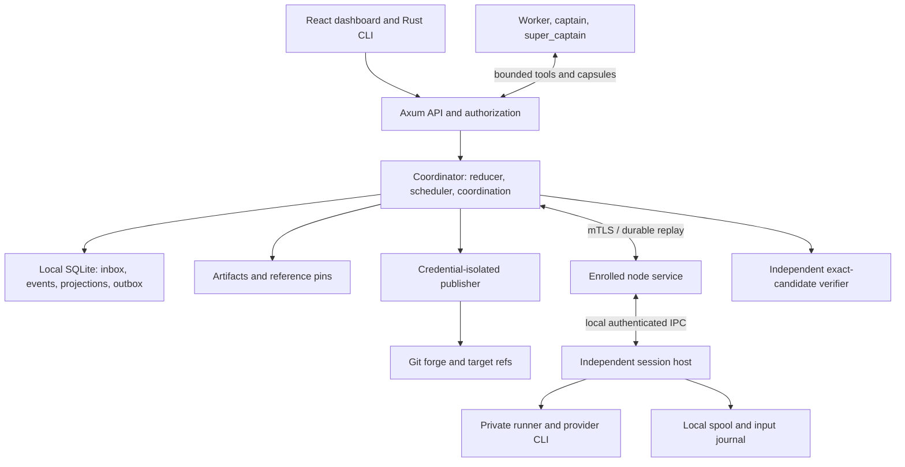

# Admiralty implementation and fleet rollout plan

**Date:** 18 October 2026  
**Planning baseline:** `neverhuman/admiralty` at `1e8ed17eff27ed3ab80dc6860fc8eda301406aee`  
**Target:** Rust control plane and CLI; SQLite; Vite, TypeScript and React dashboard  
**Status:** Implementation in progress; current source, checks and remaining gates are recorded in [EXECUTION.md](EXECUTION.md). Existing fleet remains operational. The 18 October work-order review adds the requirements in [WORK_ORDER_REVIEW.md](WORK_ORDER_REVIEW.md); it does not mark them implemented.

Build on Admiralty's working dashboard, project knowledge and operational rules. Replace expensive conversational coordination with a durable coordination system. Most inference should solve tasks; captains should spend little context deciding what needs judgment, and the super_captain should handle cross-project exceptions. Preserve detailed evidence outside model context and retrieve only what a decision needs.

The first useful release is a fast, read-only dashboard plus compact coordination packets over existing sources. The first managed release proves one complete task: dispatch, independent supervision, bounded communication, verification, accounted usage, integration under existing policy and safe closeout. Expand that proven loop across projects, providers and enrolled machines.

## 1. Objective and completion contract

### 1.1 Required outcomes

1. Run many projects and dependency-rich workplans across an arbitrary enrolled fleet. Node identity, project names, provider profiles and hierarchy are configuration, never production constants.
2. Make inter-agent coordination a first-class subsystem: durable messages, shared state, selective subscriptions, ownership, interface handoffs, questions, decisions and context recovery.
3. Keep routine monitoring, status aggregation, readiness checks, dispatch and bookkeeping in Rust. A healthy, unchanged fleet requires zero model turns.
4. Allocate the great majority of model consumption to task execution. Measure captain, super_captain, routing, summarization and other coordination costs separately and include them in total economics.
5. Preserve and improve the current dashboard's dense situational awareness while adding clear navigation, evidence drill-down, workplan management, installation and fleet onboarding.
6. Produce independently verified progress. An agent's final message, process exit or claimed test result does not establish acceptance.
7. Survive coordinator, node-service and UI upgrades without terminating qualified active sessions or losing acknowledged events.
8. Ship a simple local-first open-source product: a credential-free demo, guided setup, bundled dashboard, transparent support matrix and reproducible qualification.
9. Implement the full core backlog below, including quality, cleanup, accounting, continuous integration, excursions and controlled prompt/policy improvement.

### 1.2 Non-goals for the core release

Do not rebuild Git, SQLite, container runtimes, provider CLIs or terminal emulators. Do not require Kubernetes, Redis, Kafka, a hosted database, a vector database, an external telemetry account or a model server. Do not implement active-active coordinators, unrestricted agent chat, default multi-model councils, automatic arbitrary self-modification, or a neural router before reliable task data exists. MicroVMs and speculative races have explicit extension gates; they do not block delivery of the requested core fleet system.

### 1.3 Assumptions and dependencies

- Linux is the first managed fleet platform. macOS supports the operator UI/CLI and qualified trusted-local execution; Linux isolation claims do not transfer automatically to macOS. Windows support follows separate qualification.
- One coordinator owns authoritative state on local storage. Each node/session owns a separate local spool. Execution across machines does not mean sharing a SQLite file.
- Existing projects have heterogeneous ledgers, workplans, coordination files and approval rules. Their initial import is observational and preserves uncertainty.
- Provider/model names and effort levels are installation profiles. Availability, credentials, usage reporting, tool support and quotas must be probed against actual installed versions.
- Jankurai is the intended quality integration. Its executable, profile, schema, hooks and Rust/SQLite/React suitability require qualification; a high score alone does not prove functional correctness.
- The existing SSH tunnel reaches the dashboard. It does not establish the deployed Git revision, available node capacity, or authority to interrupt sessions.
- Existing deployment restrictions remain binding until explicitly revised by their owner. Import protected hosts/assets, CPU reservations and owner-only merge exceptions into private configuration.
- Public distribution depends on a maintainer-approved license and rights to the supplied logo. Prepare release materials early; settle rights before public release.

### 1.4 Global stop conditions

Pause affected admissions or effects, preserve evidence, and continue unrelated safe work when any of these occurs:

- Unknown live process ownership, duplicate writers, producer identity/content collision, stale authority, or ambiguous publication/input outcome.
- Missing essential task constraints, inaccessible required evidence, contradictory contract revisions, or unqualified provider fallback.
- Inability to durably record acknowledged control/usage events, exhausted emergency spool reserve, or failed artifact integrity.
- A candidate changes its own protected evaluator, acceptance policy, authority configuration or experiment promotion rules.
- Cleanup cannot prove exclusive custody and preservation of unique work.
- An update cannot read every active bundle's events/protocols or preserve its execution environment.

These are scoped operational states, not invitations to ask the owner about every ordinary reversible action. Execute already-authorized work within its policy and budget. Route only unresolved decisions to the appropriate authority.

### 1.5 Completion criteria

Core release completes only when a fresh user can install, run the offline demo, enroll a repository/provider, import a workplan, run bounded parallel tasks, inspect exact verification and costs, add arbitrary nodes, recover a partition, upgrade with active jobs, integrate under repository rules and retire owned scratch. The coordination system must pass loss/reorder/compaction tests and show measured context savings without losing constraints. The improvement system must support promotion, rejection and insufficient evidence, plus rollback; a forced positive result is not required.

## 2. Grounded baseline and source decisions

The checked-out baseline is later than the `9dbbec4...` baseline used by most supplied plans. It contains Python collectors, a static HTML dashboard, Screen helpers, captain instructions and sanitized history. It has no Rust workspace, React/Vite application, CI workflow or open-source license. See [SOURCE_REVIEW.md](SOURCE_REVIEW.md) for fingerprints, exact read-first paths, current counts and the six-plan reconciliation.

Observed dashboard response: 466,501 bytes, generated at `2026-10-18T09:22:51+00:00`. Source collector interval is 45 seconds; browser fetches the entire status document every 15 seconds and replaces large HTML regions. That is approximately 1.87 MB/minute of uncompressed response bodies per open viewer before transport overhead. This is a useful baseline, not a measured network throughput benchmark.

Preserve the current product strengths: project cards, stage bars, hierarchy, resource pressure, PR/CI status, quality findings, task changes, model mix, quota, token trends and session tails. Change their data model and delivery path incrementally. Do not substitute a terminal wall for workplan management.

| Disagreement or gap in source plans | Final decision |
| --- | --- |
| Compression appears late in some milestone lists | Coordination contracts, metering and deterministic packet generation begin in the first slice. |
| Extremely short prose versus clear context | Use readable typed capsules. Preserve goal, scope, negation, units, failed criteria, uncertainty and next action. No private shorthand that agents must repeatedly relearn. |
| WebSocket for everything versus separate streams | REST snapshots/commands, SSE for state deltas, WebSocket only for opened terminal attachments; node transport is separate. |
| BLAKE3 versus SHA-256 public artifact identity | Use SHA-256 for v1 interchange/manifests. Keep algorithm-qualified digest types; Git retains its native object format. Avoid two public artifact identities. |
| Worktrees versus isolation | Trusted local worktrees are an explicit mode. Fleet isolation uses private writable Git metadata in qualified rootless OCI runners. |
| Minimal versus hundreds of routing features | Record a small point-in-time manifest now. Keep an extensible registry; large feature extraction and learned routing follow demonstrated value. |
| Always-on captain loops | Captains are bounded decision jobs over shared durable state. Rust generates routine reports and dispatches eligible work. |
| Mandatory quality tool before anything works | Offline demo and read-only mode work without Jankurai. Managed acceptance requires the configured qualified quality profile; no silent substitution. |
| Automatic issue publication | Generate local sanitized proposals first. External publication uses an explicit configured grant and the publication gateway. |
| Promised 10x compression or huge fleet scale | Treat as hypotheses. Publish measured token, quality and runtime results under a declared workload. |

## 3. Repository layout and ownership

Repository root for this workspace is `/Users/bentaylor/Documents/ChatGPT/admiralty`. All paths below are relative to that root unless explicitly absolute. Existing files are read-first references; target paths do not exist until their work packet creates them.

Use a small number of crates with internal modules. Keep domain types independent of web, SQL and process APIs.

```text
Cargo.toml                         # workspace; single integration owner
Cargo.lock
rust-toolchain.toml
crates/
  admiralty-core/src/
    ids.rs contract.rs state.rs events.rs policy.rs reducer.rs
    coordination/{message,mailbox,topics,claims,decisions,context}.rs
    scheduling/{admission,fairness,routing,recovery}.rs
    economics/{usage,budget,valuation,cohort}.rs
  admiralty-store/
    migrations/0001_foundation.sql ...
    src/{writer,inbox,outbox,artifacts,backup,projections}.rs
  admiralty-runtime/src/
    session/{host,identity,journal,input,spool,terminal}.rs
    providers/{mod,fake,codex,claude,process}.rs
    providers/{agy,grok}.rs
    workspace/{registry,git,runner,resources,cleanup}.rs
    verification/{candidate,oracle,receipts,jankurai,checks}.rs
    integration/{conflict,train,publisher,reconcile}.rs
    fleet/{enrollment,transport,transfer,placement}.rs
    operations/{release,upgrade,recovery}.rs
  admiralty-server/src/
    api/{auth,queries,commands,events,terminals,agent_tools}.rs
    services/{coordinator,legacy,coordination,metrics}.rs
    services/improvement/{excursions,proposals,experiments,datasets}.rs
    main.rs
  admiralty-cli/src/{main,doctor,init,demo,project,node,work,export}.rs
  admiralty-testkit/src/{fake_provider,forge,clock,faults,fixtures}.rs
apps/dashboard/
  src/{app,api,components,features,styles}/
  src/features/{overview,projects,workplans,agents,coordination}/
  src/features/{integration,economics,quality,incidents,experiments,settings}/
  public/brand/
  e2e/
protocol/{node.proto,agent-tools.schema.json,compatibility.json}
schemas/                           # generated public JSON Schema; never hand-edit
packages/contracts/                # generated TS and runtime validators
configs/{defaults,profiles,examples}/
tests/{integration,fixtures,qualification}/
benchmarks/{profiles,results}/
scripts/{dev,check,package,release}/
packaging/{systemd,launchd,containers}/
docs/{architecture,protocol,operators,contributors,brand}/
docs/plans/admiralty-v2/            # this plan, ledger and implementation receipts
```

### 3.1 Ownership and conflict rules

The integration owner alone edits root manifests/lockfiles, migration numbering, public schema generators, `protocol/`, generated `schemas/` and `packages/contracts/`, API compatibility policy and shared CI configuration. Other workers submit exact requested changes in their handoff. Do not let several agents independently regenerate shared contracts.

Runtime, provider, coordination and frontend workers own disjoint modules within a packet. A directory is not carte blanche: each packet's allowlist applies. `mod.rs` and shared wiring belong to the integration owner whenever parallel workers would collide. Integration consumes worker commits after their checks, updates wiring once and reruns affected integration tests.

Existing `dashboard/`, `captains/`, `tools/` and `data/history/` are migration references. Do not refactor them during foundation work. `data/history/` is a read-only input dataset for implementation agents. Its existing export exception does not authorize new code changes directly on main. Never edit live symlink targets, private runtime, provider credentials, unrelated project trees, CI runner services or unmanaged assets during implementation tests.

Build outputs (`target/`, frontend `dist/`, dependency directories), generated contracts and test databases are not hand-edited source. Keep runtime databases, raw transcripts, private deployment configuration and secrets outside Git. Existing root `.gitignore` ignores `*.jsonl`; use tracked `.json`/`.ndjson` fixtures or a narrow explicit exception rather than accidentally omitting conformance inputs.

## 4. Runtime architecture and authority



`admiraltyd` owns coordination, policy, dispatch, SQLite writer, query projections and static UI serving. `admiralty-node` owns host inventory and local runner provisioning. `admiralty-session` owns a provider process, pipes/PTY, process identity, input arbitration and spool. These may ship in one release archive, but session hosts have independent process/service lifetimes. `admiralty` is the operator CLI; a subcommand can start each role without requiring four separate installers.

Create native node/session entrypoints at `crates/admiralty-runtime/src/bin/admiralty-node.rs` and `crates/admiralty-runtime/src/bin/admiralty-session.rs`. The server crate builds `admiraltyd`; the CLI crate builds `admiralty`. Package them together. Do not trade process isolation for a literal single-process implementation.

A verifier runs in a clean, pinned environment with the protected oracle. The publisher holds upstream write credentials; workers do not. Workers submit candidates and proposals. Normal task, verification and reversible operations proceed under existing grants; policy changes and owner-only actions route to the owner.

Use Tokio/Axum/Tower/rustls, `rusqlite` on a dedicated bounded writer thread, Serde/Schemars with one Rust-to-TypeScript generation pipeline, Tonic/Prost for node RPC, `clap`, `tracing`, bounded `aho-corasick`/`regex`, a qualified VT parser and system Git via argv. Blocked SQLite, Git, compression and portability-layer PTY operations must not occupy Tokio executor threads. Bound blocking concurrency and make cancellation semantics explicit. [Tokio blocking task guidance](https://docs.rs/tokio/latest/tokio/task/fn.spawn_blocking.html)

React uses strict TypeScript, TanStack Query/Table/Virtual, ECharts for plots, an optional graph view and lazy xterm.js. Vite builds static assets; the production Rust server serves them. No Node service is required for Admiralty's control plane. Provider CLIs and project toolchains may have their own runtime dependencies. [Vite production deployment](https://vite.dev/guide/static-deploy.html)

## 5. Inter-agent coordination system

This subsystem is essential infrastructure, not a chat feature added after scheduling. Its job is to deliver the smallest sufficient information to the right agent at the right time, preserve meaning across failures, and avoid involving managers when a deterministic action or bounded peer exchange suffices.

### 5.1 Shared state and role responsibilities

Canonical state lives in typed contracts, events, decisions and artifact references. An agent conversation is a temporary view of that state, never the only copy of a plan or decision.

| Role | Receives by default | Owns | Wakes when |
| --- | --- | --- | --- |
| Worker | One task contract, required code/interface slice, current evidence and budget | Implementation candidate, scoped questions and handoff | Task starts, required dependency changes, verification feedback or relevant answer arrives |
| Captain | Changed project critical path, unresolved exceptions, integration/budget deltas | Decomposition, packet repair, unfamiliar recovery, project-level decisions | Rust cannot resolve a consequential project choice within policy |
| Super_captain | Cross-project resource/deadline conflicts and captain decision requests | Portfolio priorities and delegated reversible choices | A project decision exceeds captain authority or affects another project |
| Rust services | Complete authorized canonical state | Readiness, ordinary dispatch, reports, retries by rule, checks, transport and housekeeping | Events, deadlines and resource changes |

Retain familiar captain/super_captain terminology in the UI, but use configurable role definitions and scoped capabilities. A large workplan can have nested teams; presentation parentage does not automatically grant authority.

### 5.2 Durable coordination bus

Implement an inbox/outbox-backed broker inside the coordinator. Use local SQLite plus node spools; no external message broker is required initially. Separate durable business messages from disposable UI frames.

Message kinds: `TaskAssigned`, `TaskChanged`, `ProgressChanged`, `ArtifactReady`, `InterfaceProposed`, `InterfaceAccepted`, `QuestionAsked`, `QuestionAnswered`, `DecisionRequested`, `DecisionRecorded`, `VerificationFailed`, `HandoffReady`, `ClaimConflict`, `BudgetWarning`, `CancelRequested` and `SnapshotRequired`.

Each envelope contains:

```rust
struct CoordinationEnvelope {
    message_id: MessageId,
    schema_version: u32,
    sender: PrincipalId,
    recipient: RecipientScope,
    topic: TopicId,
    root_id: RootId,
    task_revision: Option<TaskRevisionId>,
    causation_id: Option<MessageId>,
    correlation_id: CorrelationId,
    source_cursor: Cursor,
    authority: AuthorityRef,
    context_epoch: Option<ContextEpoch>,
    baseline_digest: Option<Digest>,
    protected_facts_digest: Digest,
    payload_ref: ArtifactRef,
    priority: Priority,
    expires_at: Option<Timestamp>,
}
```

Fields are canonical contract sketches, not permission to omit detail from generated schemas. Full IDs/digests stay on the machine wire. Model-facing short handles are collision-checked, scoped and resolvable.

Persist before ACK. Identical identity/payload retries return the original result; changed payload under an existing identity raises an integrity incident. Preserve causation chains. Deliver at least once with idempotent state application. A transport ACK means durable receipt; a provider ACK means delivery; neither proves comprehension or successful action. Paid turns and arbitrary terminal writes do not get a fictional exactly-once guarantee.

Order messages within task/decision streams, not through one globally blocking conversation. Use expected revisions and source watermarks to detect stale inputs. Priority classes reserve space for control/decision/usage events; large raw output cannot starve them. Expired messages produce visible expiry/disposition events rather than silently becoming decisions.

### 5.3 Selective subscriptions and attention control

Subscribe by assigned task, explicit dependency, owned interface, project decision queue or fleet resource obligation. The router resolves scope and recipient authorization before delivery. No fleet-wide raw transcript broadcasting.

Coalesce repetitive progress into current state plus counts and first/last observation times. Preserve important intermediate transitions and every control/usage fact. Routine telemetry updates the dashboard without waking a model. Batch low-priority related exceptions into one decision capsule. Use configurable short debounce windows, deadlines and critical-path urgency; urgent loss of authority or changed acceptance is not delayed by batching.

Apply per-root/per-role message and token budgets, duplicate-question fingerprints and a maximum open-question count. A reply storm becomes one incident with a compact dossier. Suppressing delivery never removes the underlying evidence or hides an unresolved blocker.

### 5.4 Direct worker coordination

Workers may exchange a bounded interface artifact or ask a scoped dependency question without passing the full conversation through their captain. They cannot reassign work, expand protected write scope, alter acceptance or grant publication authority through prose.

Example: an API worker publishes an immutable schema candidate. The UI worker receives `ArtifactReady` with schema revision, compatibility requirements and a narrow diff. Its tools fetch the relevant schema and examples. It returns an acceptance or a structured incompatibility. The captain wakes only if the contract must change or ownership cannot be resolved.

An `InterfaceContract` binds producer task, consumer tasks, schema/content digest, compatibility policy, acceptance checks and status. A consumer can develop against an explicitly provisional artifact, but final acceptance verifies the exact required producer revision. Dependency revocation invalidates affected readiness and receipts; it does not erase prior work.

### 5.5 Ownership and collision avoidance

Maintain durable write claims for workspace, path/module, integration target and sensitive shared files. Reserve claims in the same admission transaction as budgets and resources. Use canonical paths, case rules and normalized repository identities; reject path traversal and ambiguous aliases.

Path claims are a coordination mechanism, not a substitute for isolation. Separate workspaces may modify the same source path, but the scheduler marks the merge risk and can serialize hot interfaces. A single checkout never has two ordinary writers. Acquire multi-resource claims in a stable order to avoid deadlock; surface cycles and wait age.

Lease expiry starts reconciliation. An unknown process retains its logical ownership until termination or effect fencing is proved. Do not release a workspace merely because its node missed a heartbeat. Explicit speculative attempts require separate workspaces and a shared capped budget.

### 5.6 Questions and decisions

A question includes the blocking requirement, exact candidate/interface revision, evidence excerpt, options when useful, requested authority, deadline and work that can proceed meanwhile. Rust first answers deterministic queries from current state. Route remaining questions to the owning worker/interface owner, then captain, then super_captain, then owner as authority requires.

Question states: `open`, `routed`, `answered`, `superseded`, `expired`, `cancelled`. Decision states also distinguish a proposed answer from an authorized committed decision. The effective decision records actor, scope, policy hash, expected revision and affected tasks. Reusing a similar old decision requires matching its scope and current facts. Text saying “approved” is not authority.

### 5.7 Context compiler and recovery

Maintain three representations: full canonical facts; operational projections; bounded model capsules. Compiler functions are `compile_task_capsule`, `compile_decision_capsule`, `compile_handoff`, `compile_project_exceptions` and `compile_fleet_exceptions`.

Compile essential material first: goal and acceptance, write/deny scope, authority, immutable base/interface references, current failed criterion, relevant evidence, unresolved uncertainty, budget and next permitted action. Add background only when needed. If essentials exceed budget, expand under policy or split the task; never truncate them to satisfy a token target.

Track recipient session, context epoch, acknowledged baseline and fact versions. Deltas name their baseline and resulting protected-fact digest. Restart, provider compaction, model switch, uncertain input or baseline mismatch requires a fresh capsule. For opaque CLIs without reliable context-epoch visibility, include a complete concise protected capsule at each decision boundary. Delta transport remains useful, but the system must not assume invisible memory survived.

Initial role targets, before requested code/evidence:

| Packet | Starting budget | Invocation policy |
| --- | ---: | --- |
| Machine progress delta | No model tokens | Update projections only |
| Worker bootstrap | 1,000–2,500 tokens | One complete bounded task |
| Worker failure/handoff | 300–800 tokens | Exact failed criterion and retained candidate |
| Captain decision | 300–1,200 tokens | One decision or tightly related batch |
| Super_captain decision | 400–1,500 tokens | Cross-project exceptions only |

These are tuning targets, not hard truncation limits. Cache stable prefixes where the provider supports them. Start new bounded tasks with clean relevant context; retain useful active work when a forced reset would increase cost. Charge summarization, retrieval, replayed history, tool schemas and retries to coordination overhead where appropriate.

### 5.8 Bounded agent tools and MCP facade

Expose a small provider-neutral tool surface: `task_get`, `context_get`, `evidence_get`, `interface_get`, `question_submit`, `candidate_submit`, `decision_submit` and `budget_get`. Role-specific tool lists exclude irrelevant operations. Outputs include source cursor, revision, freshness, omission count and bounded continuation. Large outputs return a handle plus a short discriminating excerpt.

Use a Rust MCP facade for qualified clients, initially stdio; remote transport follows its own authentication and compatibility gate. Provide the same semantics through `admiralty agent ... --json` for clients lacking compatible tool integration. Do not introduce a second agent-control database or treat MCP notifications as durable task delivery. MCP provides a context/tool interface; Admiralty still owns scheduling, messages, budgets and authority. [MCP architecture](https://modelcontextprotocol.io/docs/2026-07-28/learn/architecture), [official Rust SDK](https://github.com/modelcontextprotocol/rust-sdk)

Do not implement competing A2A/MCP/custom chat systems in parallel. Ship one canonical coordination model, then add interoperability adapters when a real integration requires them.

### 5.9 Coordination qualification and economics

Measure model tokens and spend by role and purpose, not only sender. Worker coding/review/diagnosis belongs to task execution; manager decomposition, routing judgment, summaries and hierarchy handoffs belong to coordination. Preserve provider-native token categories; cross-tokenizer totals are descriptive and cannot replace comparable spend.

For a declared representative workload, target at least 90% of observed model-token consumption at task level, with captain/super_captain and other coordination at most 10%; stretch coordination target is 5%. Use a separate prospective hypothesis of at least 70% less coordination context than the existing full-report loop. These are targets requiring evidence, not universal guarantees: tiny tasks and unusually hard planning can change the ratio. Report all-in cost, acceptance, rework, latency and coverage so a low manager share cannot be manufactured by wasting worker tokens.

Conformance includes dropped/duplicated/reordered messages, missing ACKs, producer restart, context compaction, unavailable artifacts, similar IDs, stale revisions, negation/unit preservation, cross-project access denial, simultaneous claims, question storms and provider-internal opaque subagents. Every protected machine fact must survive compilation exactly. Evaluate actual decision quality on frozen paired fixtures; token reduction alone does not pass.

### 5.10 Context growth governor and prompt compilation

Record context composition per observed provider request: harness/system/tool-schema floor, stable role prefix, task contract, retrieved code/evidence, conversation history, cached/uncached categories and generated output. Exact decomposition may be unavailable in opaque CLIs; preserve estimated/unknown status and use total reported usage for economics. An empty-turn probe is a bounded qualification expense, not proof that every later request has the same hidden floor.

Default managed sessions are bound to one task, with explicit revision/attempt segments. Prevent unrelated tasks from accumulating in one long conversation. Captain and super_captain decision jobs start from a current exception capsule and retained decisions, rather than replaying their previous transcript. Reuse compatible stable prefixes where measured provider caching helps.

Rotate or checkpoint an active worker only when a qualified capability supports it and expected remaining replay cost exceeds cold-start, capsule, lost-cache and rediscovery cost, or a declared context limit requires it. The estimate uses native price categories and uncertainty; fixed turn counts, hardcoded vendor price cliffs or “cached input exceeds 50%” are not sufficient economic proof. Persist candidate, failed approaches, exact next checks and essential obligations before handoff. At a hard spend limit, do not automatically buy another wrap-up turn unless it is already reserved and authorized; deterministic retained-state capture remains available.

Compile role bundle, effective project policy, contract, interface slice and current exception as one versioned prompt artifact. Reject contradictory/superseded instructions and record each component digest plus final rendered digest. A short alias is introduced once, never rebound within a context epoch, and included in the fresh capsule if still needed. Qualify aliases against actual tokenizers where available; bytes saved are not assumed to be tokens saved.

For the machine-readable fact subset require `parse(render(facts)) == project(facts)`. Mutation tests remove negations, change units/thresholds, swap task IDs, conflate proposed/decided and not-run/passed, or forge a legacy/verified distinction; each must fail. Free prose does not acquire a “lossless” claim from matching numbers/handles. Test comprehension of constraints separately, and treat a model-generated ACK as delivery/application evidence rather than proof it will retain the facts after compaction.

### 5.11 Structured tool results and failed-approach memory

Parse supported compiler/test/quality output into failed check, exact assertion, file/line, environment, fingerprint, repeat count and bounded excerpt. Preserve the full log by digest and allow precise range retrieval. Unknown output formats receive a bounded raw excerpt with an explicit parser gap. Do not collapse distinct attempts or omit an intervening success when grouping repeated errors.

Maintain a task-scoped tried-approach register: hypothesis, candidate/patch, relevant checks, result and negative evidence. Recovery workers fetch this register rather than relearning the same failure from transcripts. A tentative diagnosis stays a hypothesis until independently supported. The Coordination view displays exactly what a recipient saw next to its expanded canonical facts and source cursor.

## 6. Contracts, storage and effect correctness

### 6.1 Work model

Use stable `FleetId`, `NodeId`, `ProjectId`, `RootId`, `PlanRevisionId`, `TaskId`, `TaskRevisionId`, `AttemptId`, `SessionId`, `CandidateId`, `ReceiptId`, `MessageId` and `AuthorityScopeId`. IDs are serialized as strings. Root goals keep economic lineage across splitting, retries, reassignment and reopening.

`TaskContract` contains objective, non-goals, immutable criteria, owned/forbidden paths, read-first references, dependency/interface revisions, base commit, environment/runner requirements, budget, deadline, responsible role and required delivery stage. Commands are argv plus cwd, environment allowlist and timeout, not interpolated shell strings. An explicitly necessary shell command declares its interpreter and trust boundary.

Retain the originating request as an immutable, bounded `WorkOrderRevision`, with rationale, source artifact/digest, requester attribution and its trust level, capture identity/time, requested timing and explicit one-to-many links to task contract revisions. Imported request text cannot grant execution, merge or release authority; authenticated requests use existing policy and grants. Materialize essential constraints in the worker capsule; resolving the original chat must not be a prerequisite for doing the task. Version new public contracts deliberately rather than adding fields silently to the current closed v1 schema. See WORK_ORDER_REVIEW §3.

Keep scheduling (`blocked/ready/claimed/running/awaiting_decision/closed`), attempt outcome (`unknown/succeeded/failed/cancelled`), delivery (`candidate/verified/queued/in_pr/on_main/accepted/reopened`) and observation freshness separate. The UI derives meaningful headline states while exposing the dimensions. “Passed in a lane” is not “accepted on main.”

Preserve check and review observations independently, plus per-repository merge outcomes and per-target package/staging/install/running/release receipts. Required delivery stage is a task contract choice; a source-only task may complete before deployment, while a release task requires its configured release evidence. Never promote an imported `done`, a tracking trailer, merged PR or available package into deployed/released status. Reopening supersedes current selection without deleting historical receipts.

### 6.2 Store and migrations

Use local WAL, foreign keys, bounded writer/read queues and `synchronous=FULL` for acknowledged authoritative state. Qualify the actual linked SQLite source identity, including the WAL-reset fix in 3.51.3 or later/fixed backports. Readers remain short-lived; heavy exports use snapshots. Nodes never mount this database over NFS/sshfs. [SQLite WAL guidance](https://www.sqlite.org/wal.html)

Ordered migration families:

1. `0001_foundation.sql`: projects, roots, plan/task revisions, dependencies, attempts, source inbox, domain events, outbox, authority generations.
2. `0002_coordination.sql`: messages, deliveries, subscriptions, recipient epochs, questions, decisions, interface contracts and claims.
3. `0003_evidence_assets.sql`: artifacts, locations, pins, assets, candidates, oracle manifests, receipts and revocations.
4. `0004_economics.sql`: usage observations/revisions, model segments, prices, allocations, budget reservations, liabilities and settlements.
5. `0005_operations.sql`: nodes, capacity, release bundles, update jobs, backups and integration/publication intents.
6. `0006_improvement.sql`: excursions, families, proposals, prompt bundles, trials, assignments, outcomes and promotion decisions.

Allocate identity/index/state columns explicitly; extensible versioned JSON is not the place for scheduling joins. Immutable records are corrected by new revisions with one explicit active selection. Use unique constraints for source identity and command keys, partial uniqueness for ordinary active claims and foreign keys for evidence lineage. Cross-row policies and allowed transitions belong in the writer/domain layer; do not assume DDL alone enforces them.

### 6.3 Event and admission transaction

Producer observations are untrusted facts about what was seen. Domain events are coordinator-authorized state transitions. Persist producer identity, incarnation, contiguous sequence, observed time and canonical digest. A source claiming `TaskAccepted` cannot bypass trusted verification.

```text
BEGIN IMMEDIATE
  compare task/plan/policy revisions and authority generation
  verify dependencies, provider/runner capability and evidence availability
  check budget liabilities, node resources and integration WIP allowance
  acquire ordinary execution/write claims
  allocate attempt, session, context and routing-decision identities
  reserve budget/resources and pin required artifacts/bundle
  append authorized event, projections and durable launch outbox entry
COMMIT
send launch command; reconcile result through receiver journal
```

No network call, model turn, Git operation or long compression occurs inside the transaction. The pure reducer receives explicit time and recorded nondeterminism; replay reconstructs projections without repeating effects.

### 6.4 Authority and external effects

Persist the highest generation for each authority scope independently of expiring leases. Effect sinks validate scope plus generation. Credential isolation makes the publication boundary enforceable; a stale worker cannot bypass SQLite policy using a cached upstream token.

An outbox intent transitions through prepared, durable-delivered, started, completed/rejected or outcome-unknown. A timeout after a possible remote merge or PTY write retains uncertainty and the target slot. Reconcile by stable identity and remote/process evidence before retrying. Do not equate at-least-once transport with exactly-once external effects.

### 6.5 Artifacts, backup and retention

Artifact publication writes a temporary object, verifies size/digest, syncs it, atomically renames and syncs its parent before committing the authoritative availability reference. Crash recovery finds orphans and missing payloads; required evidence is never acknowledged as present before it is durable.

Backups use SQLite's supported backup API and include actual snapshot watermark, schema/event versions, recovery generation, artifact closure and active bundle references. Pin the closure while retained. Restore fences old credential-bearing executors before new effects, reconciles node spools and remote mutations, and establishes a fresh externally protected recovery generation. A rolled-back DB counter cannot fence an old live publisher. [SQLite online backup](https://www.sqlite.org/backup.html)

## 7. Sessions, providers, detection and resource control

### 7.1 Durable supervision

Session hosts own child process groups, descriptors, resize/input and reaping. Process identity includes boot identity plus start time or an equivalent qualified OS handle; PID alone is insufficient. Persist a run manifest before spawn and reconcile the crash gap after child creation using stable run/cgroup identity. Never launch a replacement simply because the launch-result row is missing.

Use structured headless provider protocols first; qualify resumable structured interfaces where useful; use Rust-owned PTYs as fallback. Terminal parsing handles split UTF-8, ANSI redraw, carriage returns, oversized frames and fragmented JSON. A bounded recent-output ring is an interactive cache; durable spools retain required events separately.

Session units are independently supervised and must not share a coordinator service stop lifecycle. Test actual service-manager behavior, including shutdown/restart, rather than adding a `KillMode` setting and assuming survival. [systemd process termination semantics](https://www.freedesktop.org/software/systemd/man/latest/systemd.kill.html)

### 7.2 Input ownership and legacy sessions

One ordered input owner per session. Human attach preempts queued automation and increments the input epoch. Automated input carries expected session/turn/context epoch and scoped authorization. A crash after bytes may have been written becomes `outcome_unknown`; do not blindly replay.

Existing Screen processes are observed legacy sessions. Capture exact host/user/server/session/window identities using fresh unique capture paths and explicit timeouts. Failed captures invalidate freshness. Do not attach with `screen -r`, inject into ambiguous names, or claim an existing PTY can simply be adopted. New managed attempts use native session hosts; old work drains or follows an explicit custody handoff.

### 7.3 Provider contract

`ProviderAdapter` implements capability probing, launch-spec construction, bounded event parsing, actual execution configuration binding, usage normalization, input/turn semantics, resume/checkpoint where supported and termination reconciliation. Each release records CLI digest/version, event schema, supported model/effort profiles, permission behavior, nested-agent usage, cost coverage and known gaps.

Ship fake provider first, one qualified real structured adapter next, then a second provider. Preserve current agy/Gemini, Codex, Claude and Grok workflows through observed legacy support while each native adapter earns its capabilities. A generic process adapter can report output and lifecycle with unknown usage; it cannot advertise structured billing or reliable permission semantics it lacks.

### 7.4 Deterministic detection and recovery

Track output, tool/process, filesystem/candidate and semantic progress independently. Record seven clocks where supported: last byte, provider event, tool heartbeat, artifact change, distinct command, completed check and verified milestone. Missing signals remain unknown. Use versioned signature packs and state machines for known failures, approval prompts, quota waits and repetition. Silence during a long compiler job is not automatically a stuck model. Terminal text is observation, not authorization.

Filter packs declare sources/regions, corroboration, suppression, cooldown and negative fixtures. Include quoted/historical approval text, negated errors, expected failing tests, compiler lock waits and placeholder strings in documentation. Golden recordings are versioned per exact provider/dialect. Canary a new CLI against parser/lifecycle/usage/context-overhead fixtures before new admissions adopt it. Detection precision/recall is reported per state with fixture counts; a fast positive-pattern detector is not a universal two-second stall guarantee.

Recovery ladder: classify known transient wait; repair operational failure; repair task/scope; request one focused decision; allow a bounded same-route repair with a new hypothesis; escalate capability when evidence and remaining budget justify it. Record all retained edits and failed costs. Do not spend stronger-model tokens fixing a missing allowlist entry.

### 7.5 Isolation and capacity

Trusted-local mode uses registered worktrees with explicit shared-host trust. Fleet mode uses private clones seeded from verified mirrors/bundles inside qualified rootless OCI runners, scoped mounts/secrets and cgroup v2. No shared writable Git administration, container-engine socket, forge credential or unrestricted host home. Worktrees are useful development tools but do not constitute a sandbox. [Git worktree documentation](https://git-scm.com/docs/git-worktree)

Reserve agent conversation slots separately from build/test CPU, memory, disk/inodes, process limits, GPUs and integration slots. Use pressure/throttling/OOM observations, not load average as a CPU-percent proxy. Respect private deployment CPU exclusions and foreign workloads. Warm immutable toolchains/dependencies; use isolated build outputs and correctly keyed caches. Node enrollment never automatically authorizes GPU work.

## 8. Workplans, scheduling and integration

### 8.1 Import and author workplans

Support typed JSON/TOML contracts plus guided Markdown import. The importer previews detected task IDs, dependencies, criteria, ownership, ambiguous rows and source locations. It cannot infer acceptance from a checkbox alone. Preserve original IDs and provenance; changing the canonical contract creates a revision. Export readable Markdown/status views for existing readers.

Add a simple request → preview → explicit record boundary ahead of plan registration. A multi-paragraph request remains one work order unless the caller supplies explicit item boundaries; suggested independent outcomes are previewed with their source spans before recording. Search duplicate candidates across all task states within authorized scope, including completed/reopened work. Exact command/source replay is idempotent; similarity is advisory and cannot silently discard a request. Registration, execution admission and external publication remain separate operations. A read-only todoq family adapter may import pinned source observations without changing its queues or executing imported setup/check text. Detailed worker packets and failure cases are in WORK_ORDER_REVIEW.

Plan validation checks cycles, duplicate IDs, inaccessible references, unsatisfied interfaces, conflicting ownership, missing criteria, impossible budgets and required tools. Distinguish a dependency blocker from a decision blocker and an infrastructure wait. Replan only affected subgraphs. Cross-project dependencies name explicit interface/evidence contracts and visibility grants.

Add a packet linter before any model launch: command/check existence; criterion fingerprint; owned-path closure; required deliverable type; known affected-test closure; pinned interface availability; context estimate; budget/capability; conflict claims; forbidden paths; unresolved questions. Use import/registration graphs and sibling-key scans to suggest missing scope, but unknown static analysis cannot prove closure. Bug-fix tasks can require a base-failing/result-passing fixture; refactors, documentation and new capabilities use appropriate explicit criteria rather than a universal red-to-green requirement. Expensive collect/compile preflight runs in a bounded tool job and reuses qualified results, not in the admission transaction. Lint cannot guarantee a specification has no semantic defects.

### 8.2 Scheduling and routing

Use weighted deficit fairness across projects, aging against starvation and critical-path priority within a project. Enforce project/account/node caps and integration backlog limits. Placement considers qualification, data locality, warm environment, capacity and custody. Role hierarchy is not a requirement to ask a captain before every ready-task dispatch.

Scheduling profiles may declare immediate or scheduled work, an IANA timezone, admission windows, holidays/override policy and optional shift grouping. Keep priority distinct from eligibility and authority. Do not hardcode night mode, a timezone, a branch prefix or product-family names from an imported installation. Persist the resolved UTC window and local shift identity with the policy/tzdb version; test midnight, daylight-saving gaps/folds and a window crossed during restart. An immediate request never bypasses a dependency, resource permit, budget or approval rule.

Reserve finishing capacity explicitly: initial configurable pools may allocate 20% of build/test capacity to verification/integration and 10% to repair, subject to actual resource constraints. Use measured accepted throughput and target lead time to tune WIP with minimum/maximum bounds and hysteresis; bootstrap conservatively when throughput is unknown. Enter project-scoped finish mode when configured red-train age or zero-acceptance/WIP thresholds are exceeded: stop new feature lanes, prioritize culprit repair, verification and conflict resolution, and keep other projects moving. Initial example triggers are 20 minutes red or 60 minutes without acceptance above minimum WIP; tune from the deployed workload. A typed expiring override is visible and costed.

Routing selects the cheapest qualified capable profile under task risk, deadline and complete expected recovery cost. Model tiers are aliases, not fictional cross-vendor equivalence. Record decision-time features, eligible actions, exclusions, selected rule/probability and actual observed execution separately. Start with approximately 24 inexpensive contract/scope/validation/budget/health/conflict features; continuation features cannot leak into the initial decision.

### 8.3 Independent verification and Jankurai

Freeze the candidate's exact tree, base/parents, scope and oracle closure. Run declared checks in a clean pinned verifier. `VerificationReceipt` binds contract, tree, environment, toolchain, commands and exits, report digests, policy and trusted issuer. Worker-produced receipts are proposals until independently verified. A receipt for one checkout cannot accept another SHA; port the existing `sc_audit.py` mismatch regression immediately.

Qualify Jankurai on Admiralty's own Rust/SQLite/React profile before treating it as a gate. Preserve existing hook chains and `core.hooksPath`. For commit feedback, materialize the exact staged index without stashing/resetting the user's worktree; handle alternate index, partial staging, linked worktrees, unborn HEAD, renamed/binary/untracked candidates and profile changes. Show working preview, staged, integration and main scores as separate series. Hard findings and functional checks remain independent of numeric score.

Protect tests/fixtures, quality profiles, exclusions, baselines, workflows and oracle manifests from unilateral worker relaxation. An intended oracle change is a separate reviewed contract, not an incidental passing edit.

### 8.4 Fast continuous integration

Use ownership/path overlap first, common-base hunk analysis next, then actual Git merge probes and affected dependency checks. Add symbol/build indexes asynchronously; unsupported semantic analysis broadens checks rather than declaring safety.

Use `git merge-tree --write-tree` where qualified for preflight, preserving ancestry/base identities. A clean textual merge is not a semantic pass. Verify combined candidates, including three-way interactions. Proof cache keys include candidate/base/parents, contract, toolchain, environment, dependencies, commands and oracle/policy digests. [Git merge-tree](https://git-scm.com/docs/git-merge-tree)

Maintain one project integration writer and bounded frozen review generations. Workers continue on new lanes while a frozen PR head awaits review. A new head invalidates exact-head review evidence. Existing installation policy requires the configured reviewer on the exact current head, passing required checks and the permitted merge method; preserve owner-only exceptions. No admin/force/squash shortcut is introduced by migration.

Publisher serializes unresolved effects per repository/target ref. Remote timeout pins that slot until reconciliation. Base/head changes invalidate permits and affected validation. Track queue delay, validation delay, forge wait and rework so increasing workers cannot hide an integration bottleneck.

## 9. Honest economics, cleanup and improvement

### 9.1 Usage and budgets

Capture immutable request/turn observations with provider, model/effort segment, session/attempt/root, event time, source identity and native input/cache-write/cache-read/output/reasoning categories. Do not double-count nested usage, session totals and hourly aggregates. The first cumulative observation is a left-censored opening balance unless a zero baseline is proved. Counter resets and model changes start explicit segments.

Use checked fixed-point/rational valuation and versioned rate cards; preserve currencies, provider credits and subscription quota as different units. Unknown components stay null with coverage and liability. Shared-account activity has an unallocated bucket. Late/corrected facts append revisions and invalidate affected cohorts, rather than silently rewriting history.

Admission atomically reserves settled usage plus active reservations plus unresolved exposure at root/project/account scope. Lease expiry or requested cancellation does not release unresolved spend. State enforcement level: provider-enforced, turn-boundary supervised or estimated-only, including qualified in-flight overshoot.

Report fixed assignment cohorts containing successes, failures, cancellations, retries, coordination, review and rework. Root value is fixed before assignment; splitting a root does not manufacture more accepted value. Compare comparable task strata and required delivery stages. Keep legacy yield clearly labeled heuristic and separate from prospective verified economics.

### 9.2 Asset lifecycle

Register workspace, scratch, cache, process, spool, release bundle and retained evidence at creation. Track owner/custodian, root, node, managed root, filesystem identity, active pins, retention and estimated bytes. Asset registration starts in the first managed slice; destructive cleanup waits for its qualification gate.

Retirement transaction claims the asset and prevents new references; executor rechecks process activity, custody, clean/unpushed/ignored/private content, mount and symlink identity. Preserve unique work, quarantine when appropriate, then delete only through scoped capabilities. No broad `rm`, pattern kill, force worktree removal or foreign-path traversal. A captain sees owned cleanup debt; removing evidence needed for acceptance, backups or active jobs is never a score improvement.

### 9.3 Excursions and controlled improvement

Create typed excursion episodes for stalls, repeated failures, scope defects, conflicts, false acceptance, context errors, accounting gaps, resource incidents and cleanup violations. Deduplicate correlated events into episodes while preserving recurring families and economic lineage. Known signatures get deterministic diagnosis; unfamiliar cases receive a bounded investigator task and narrow evidence dossier.

Generate a local sanitized issue/proposal with reproduction, evidence, hypothesis, uncertainty, candidate fix and expected measurable outcome. Publish externally only through a configured grant and gateway. Do not turn every transient retry into a public issue.

Version complete role/prompt/policy/detector bundles. Trial cards preregister cohort, assignment unit, comparator, acceptance/defect guardrails, all-in cost/time endpoints, follow-up horizon, analysis and stopping rule. Shared captains/projects can contaminate task-level randomization; cluster where necessary. Retain held-out data, negative results and insufficient evidence. Models cannot edit their evaluator or promotion verdict.

Promote only eligible new work to a candidate alias; active attempts keep their pins. Roll back by restoring the champion alias for new admissions. A transparent deterministic router remains the champion until a learned alternative earns incremental net benefit after extraction, training and inference costs.

## 10. Dashboard and installation experience

### 10.1 Product structure

Default landing page answers: what changed, what blocks accepted work, what decision is needed, what is consuming budget, and where capacity is constrained. Preserve a compact fleet/project overview and provide dedicated drill-down pages instead of putting every log and chart above the fold.

| View | Core behavior |
| --- | --- |
| Overview | Accepted/delivery stages, project cards, critical exceptions, spend/coverage, capacity, next decisions |
| Projects/workplans | Searchable table and optional DAG, dependencies, plan revisions, claim ownership, ready queue, import preview |
| Project detail | Captain decisions, task trajectory, integration state, quality, budget and retained artifacts |
| Agents/sessions | Node/provider/model, lifecycle, task, freshness, progress signals; lazy tail/terminal attach |
| Coordination | Message/decision timeline, causal links, awaiting answers, subscriptions, packet inspector and role overhead |
| Integration | Frozen candidate/head, required gates/reviewer, queue age, changed-base invalidation, publication receipt |
| Economics | Role/provider/project/cache breakdown, cohort comparisons, coordination share, unknowns and metric definitions |
| Quality/assets | Exact-tree findings, scope-specific score history, owner cleanup debt, preview and disposition receipts |
| Incidents/improvement | Excursions, reproduction bundles, proposals, prompt versions, trials, promotion/rejection/rollback |
| Fleet/settings | Enroll/drain nodes, capacity/policies, provider qualification, updates, backup/restore and access |

Provide a saved **Needs attention** view across these pages: reason, responsible actor/role, age, freshness, next authorized action and bounded evidence links. Separate missing specification, decision, review, infrastructure pressure and uncertain effect outcomes. Sort actionable exceptions rather than treating every claimed task as active or asking the owner to reapprove routine work. A delivery drill-down shows request → task/attempt → candidate/check/review → per-repo merge → per-target installed/running/release observations, retaining unknown and stale states. Keep Admiralty an ordinary project tab and preserve the dense real-data console, model colors and temporal plots.

### 10.2 Interaction and visual system

Use the supplied octopus/admiral mark as the primary brand asset. Keep its original file and provenance; create derived raster sizes without inventing an authoritative vector. Obtain a deliberate simplified small-size mark/wordmark for favicon and compact navigation. Suggested palette: deep navy surfaces, electric blue primary actions and gold accents from the logo. Verify contrast for every text/status combination; model colors are secondary identifiers, never the only status signal.

Ship dark/light and compact/comfortable density, keyboard navigation, command palette, URL-backed filters, saved views, accessible labels, visible focus, reduced motion and text alternatives to charts. Target WCAG 2.2 AA in supported flows. Dense desktop mode supports current fleet monitoring; smaller widths collapse to readable project/task lists. Avoid mandatory pan/zoom graphs or constantly moving layouts.

Clicking a metric opens definition, version, cohort/window, source freshness, coverage and contributing evidence. Unknown is distinct from zero, stale from idle, simulation from live, and worker claim from accepted result. Long operations return a durable job row with progress, cancellation/checkpoint semantics and a final receipt. Reversible authorized actions do not acquire redundant confirmation dialogs.

### 10.3 Snapshot and streaming contract

Return a paginated initial projection and cursor `(recovery_generation, event_seq, projection_schema, authorization_scope_digest)`. Subscribe after that cursor; retain a bounded replay window. Entity revisions prevent stale updates. A gap, expired cursor, changed access scope or restored generation triggers resnapshot. Snapshot query and subscription boundary must not lose intervening events.

Use SSE for coalesced entity deltas and heartbeat/freshness metadata, with no per-viewer source polling. Multiplex terminal bytes separately over scoped WebSocket sessions with offsets and visible gaps. Slow viewers may drop display frames and resnapshot; they cannot stall provider capture or retain an indefinite DB read transaction. Serialize 64-bit counters/IDs safely as strings where JS numbers would lose precision.

Lazy-load graphs, xterm and heavy charts. Virtualize large lists, memoize row identity, bound client history and downsample time series on the server with extrema/gap preservation. Do not rebuild the entire dashboard DOM every tick.

### 10.4 Installation and first five minutes

Target commands below are proposed CLI contracts; none exists in the baseline yet.

```text
admiralty demo
admiralty doctor
admiralty init
admiralty project add /path/to/repository
admiralty plan import /path/to/workplan.md --preview
admiralty provider qualify <profile>
admiralty work submit /path/to/task.toml
admiralty node enroll --controller <url>
```

The release archive includes Rust binaries, static UI, migrations, default profiles, synthetic demo and doctor. No frontend build or Node installation is required to run the server/dashboard. Package archives/checksums first; add package-manager installation once signing and release automation pass. Do not publish an unreviewed curl-to-shell installer as the only route.

`admiralty demo` creates a separate ephemeral workspace, fake providers and local forge simulator, opens the UI and demonstrates work, a focused question, failure recovery, verification, accounted simulated usage and cleanup. It makes no paid calls and cannot touch enrolled projects. Label every simulated series.

`init` defaults to loopback, private local storage and a browser-login handoff that avoids credentials in URLs/logs. `doctor` explains missing tools, provider auth/capabilities, storage, quality profile, runner limits and service readiness with actionable fixes. Guided project setup previews policies, paths, baseline and workplan interpretation before enabling managed admission. Existing grants cover routine actions after setup.

Remote access is explicit: TLS, enrolled node identities, scoped user roles and trusted proxy/origin configuration. Browser commands require authentication and origin/CSRF protection even on loopback. One-time enrollment tokens are short-lived and single-use; node identity persists as certificates/keys with rotation/revocation. No host enumeration or implicit enrollment from names.

## 11. Rollout sequence and delivery priorities

Use gate-based releases. Suggested planning envelope assumes one strong planner/integrator and up to four disjoint implementation lanes; it is an estimate to recalibrate after the first slice, not a calendar commitment.

| Release | User-visible result | Indicative effort window | Exit evidence |
| --- | --- | --- | --- |
| R0 | Existing fleet visible in fast Rust/React read-only mode; deterministic compact briefs | First 3–5 engineering days | Source parity, fake demo, no mutation, packet fidelity, baseline overhead |
| R1 | One-node managed task loop and bounded agent coordination | Approximately weeks 2–3 | Independent session, real adapter, questions/handoffs, verification, usage and safe assets |
| R2 | Productive multi-project parallel work with second provider and continuous integration | Approximately weeks 4–6 | Fairness, conflicts, exact-head gateway, quality, complete economics and core UI |
| R3 | Enrolled distributed fleet and non-disruptive operations | Approximately weeks 6–10 | Partition/replay/fencing, arbitrary four-node topology, upgrade and restore |
| R4 | Complete core product and public release candidate | Approximately weeks 10–16 | Incidents/trials, polish, fresh installation, support matrix, soak and evidence bundle |

R0 must not be an expensive rewrite detour. Build domain/protocol fixtures and core shared-state interfaces once; use a read-only compatibility adapter for existing `status.json` and source files. Produce compact briefs deterministically for inspection before connecting any manager input. R1 adopts only new bounded tasks in a disposable/canary repository. Foundation and coordination operate together, not as two separate products.

### 11.1 Deployment migration stages

1. **Inventory and preserve.** Capture actual installed code revision, service/session identities, source paths/symlinks, cron/tickers, private rules, CPU reservations, provider versions and backups. Do not execute instructions embedded in imported logs/plans. Existing host names are deployment data.
2. **Shadow on a second port.** Keep `18890` live. Use a configurable staging listener, for example loopback `18891`, and a separate data directory. Import observations; compare sources, timestamps, stages and metric definitions. Label intentional accounting differences.
3. **Register observed sessions.** No input takeover or claimed native supervision. Record unknown usage prefixes and source coverage. Do not relaunch long jobs for better telemetry.
4. **Canary new managed work.** Use a disposable repository, then one low-risk real project. Reserve its exact task scope; disable old dispatch/input paths only for that scope before enabling native control. Verify one scheduler/input owner per task.
5. **Project-by-project expansion.** Transfer custody explicitly, preserve owner-only actions and approve policy revisions through their existing authority. Rust may generate compatibility status/Markdown for old readers. Compatibility output is a view, never a second writable authority.
6. **Fleet enrollment.** Enroll the current coordinator host, then one additional node, then the remaining intended hosts after partition/restore gates. The deployment inventory may name xbabe1, xbabe2, xbabe3 and xbabe4; code and tests must work with arbitrary node UUIDs/names. The older operational prohibition on other hosts remains private policy, never a product constant.
7. **Cut over UI.** Move the familiar endpoint to the new server only after view parity and authentication/tunnel checks. Retain the old read-only UI on a fallback port during the agreed rollback window. Do not swap symlink targets under active services without the deployment receipt.
8. **Retire old mutation paths.** Disable tick/kick/send/cleanup automation by exact scope after native ownership is proven and old sessions drain. Retire legacy collectors/exporters only when their consumers have migrated. Replace indefinite hourly telemetry Git commits with bounded artifact export; retain historical tracked data.

Rollback pauses new native admissions, leaves pinned sessions supervised, restores the prior qualified admission/UI path for unowned scopes and reconciles all outstanding effects. Do not run both schedulers on one scope, restore a stale DB over live state, or destroy new evidence to make rollback look clean.

### 11.2 Upgrade protocol

Check release metadata with configurable hourly jitter and an immediate manual check. Stage signed complete bundles with bandwidth/disk limits. New work can canary a bundle; active sessions retain CLI packages/runtime, adapter, runner image, prompt/policy/oracle and mutable provider-state compatibility.

Before activation, test the complete active-version matrix, not only N/N−1. Quiesce admission, drain writer/effect executors, create a backup, transfer coordinator ownership, reconcile spools/outbox and resume. Destructive migrations or incompatible shared CLI state require a provider-specific drain/checkpoint. Old bundles stay pinned until every dependent session, replay obligation and rollback window releases them. A failed compatibility gate leaves the update staged with an explicit blocker.

## 12. Worker-ready execution packets

The detailed packets are in [WORK_PACKETS.md](WORK_PACKETS.md). Treat their write allowlists and dependencies as execution contracts. A worker receives one packet plus this plan's relevant sections, not all six source documents. The integration owner supplies a current base SHA, generated interface version and any deployment-specific policy. No packet is complete without a reviewable artifact and validation receipt.

Start with P00, P01 and P02. After shared contracts freeze, run disjoint runtime, coordination, provider and UI lanes. Parallelize only the exact packet groups identified in the packet file. Shared schema, manifests, migration sequence, generated bindings and CI wiring stay with the integration owner.

## 13. Validation and release proof

All commands below are target repository commands after their owning packets create the corresponding tooling. Current repository has no Cargo/npm test system. Prefix executed shell commands with `rtk` under this workspace's global instruction; `rtk proxy` preserves raw machine-readable output when filtering would change a fixture or JSON result.

### 13.1 Standard checks

```sh
rtk cargo fmt --all -- --check
rtk cargo clippy --workspace --all-targets --locked -- -D warnings
rtk cargo test --workspace --locked
rtk cargo run -p admiralty-cli -- contracts check
rtk proxy pnpm --dir apps/dashboard install --frozen-lockfile
rtk proxy pnpm --dir apps/dashboard lint
rtk proxy pnpm --dir apps/dashboard typecheck
rtk proxy pnpm --dir apps/dashboard test --run
rtk proxy pnpm --dir apps/dashboard build
rtk proxy pnpm --dir apps/dashboard exec playwright test
rtk cargo run -p admiralty-cli -- qualify --suite core --offline
```

`contracts check` regenerates into a temporary location and fails on drift. Frontend package scripts must exist before packets cite them as passed. Run affected tests during development; run the integrated suite at release boundaries. Paid provider checks are bounded qualification jobs under an explicit budget, not parser/load test dependencies.

### 13.2 Failure and invariant matrix

| Gate | Required scenarios and result |
| --- | --- |
| Identity/replay | Duplicate sequence, producer incarnation and changed-payload collision; dedup or quarantine, never silent overwrite |
| Dispatch | Crash around reservation/outbox/receiver ACK/spawn; reconcile one ordinary execution, retain unknown ownership |
| Coordination | Loss/reorder/duplicates, storms, stale revision, revoked access, question cycles; bounded routing and visible unresolved state |
| Context | Compaction/model switch, stale baseline, unavailable reference, dropped negation/unit/ID; resnapshot/reject, never guessed obligations |
| Input | Human takeover and crash after possible write; serialized input epoch, unknown outcome, no blind resend |
| Provider | Malformed/split/oversized events, nested agents, fallback drift, silent long tool; bounded parser and honest capability/usage |
| Storage | Slow disk/full disk/inodes/WAL reader/spool pressure; bounded queues, emergency control reserve, stop admission before silent loss |
| Economics | Opening balances/reset/model switch/overlap/late charge/tiny price/failure cohort; conservation, explicit nulls and retained liabilities |
| Isolation | Shared Git/admin, credentials/mount/symlink escape, ignored files, cache poisoning, OOM/limits; claimed boundary enforced |
| Verification | Forged report, wrong checkout, mutated oracle, stale env/policy; no acceptance |
| Jankurai | Partial staging/alternate index/unborn HEAD/hook chain/profile mismatch; correct intended bytes or explicit unsupported state |
| Integration | Changed base/head, stale review, dismissal, combined semantic failure, ambiguous remote result; invalidate/reconcile, no duplicate effect |
| Cleanup | New pin versus retirement, foreign/dirty/unique/unpushed data, mount swap/process still active; preserve and refuse unsafe disposal |
| Fleet | Disconnect/reboot/clock skew/duplicate enrollment/replayed permit; contiguous ACK and no second writer or stale publisher |
| Upgrade/restore | Active old bundles, session/node/controller restart, missing backup blob, old publisher alive; continuity or staged block, fresh fencing |
| UI/API | Snapshot-subscription race, restored cursor, access change, huge counter, slow subscriber; exact state/precision/auth and bounded resync |
| Improvement | Contaminated trial, future feature, repeated peeking, immature outcomes; no unsupported promotion |
| Onboarding | Clean machine/no accounts/unsupported provider/missing quality tool; useful demo and actionable real-work diagnosis |

### 13.3 Performance envelope

Initial qualification target: Linux x86-64, 8 allocated cores, 32 GiB RAM, local NVMe; disclose exact hardware/kernel/filesystem/toolchain/SQLite source ID and release build. Use 128 connected synthetic sessions including real pipe/PTY fixture processes, 2,000 small semantic events/s and 2 MiB/s aggregate raw output for 20 minutes after warmup, with one active browser. Seed query tests separately with 100,000 tasks, one million attempts and ten million events. Publish event sizes, output entropy, durability/batching, retention and whether load/query profiles run together.

| Measurement | Proposed gate |
| --- | --- |
| Critical observation to durable ACK p95 | ≤100 ms at declared load |
| Committed state to visible browser p95 | ≤300 ms locally |
| Indexed bounded task/status query p95 | ≤100 ms at 20 queries/s |
| Cached context compilation p95 | ≤50 ms; retrieval measured separately |
| Warm dispatch to fake child ready p95 | ≤500 ms; excludes model first token |
| Visible UI interaction p95 | ≤100 ms on named browser/device |
| Initial compressed dashboard JS | ≤300 KiB, with graph/terminal/chart chunks separate |
| Aggregate control-plane PSS | ≤1.5 GiB excluding workers/browser at declared load |
| Aggregate control-plane CPU | ≤2 core equivalents average at declared load; idle measured separately |

Report p50/p95/p99, errors, queue depths, resource use and saturation behavior. These are design targets, not measured guarantees. Publish a smaller supported envelope if needed; correctness and durable backpressure cannot be traded for a headline. A 1,024-session stretch run remains a separately labeled experiment. Faster Rust coordination does not promise faster provider inference or repository builds.

### 13.4 Rollout evidence and stop interpretation

Before fleet beta, run a 24-hour synthetic soak with restarts, partitions, noisy/quiet jobs, spool pressure, update handoffs and browser reconnects. Each advertised provider/transport gets a bounded real task and continuity check. The four-node deployment topology is tested without embedding its names in code.

Release evidence includes source/release digests, tool versions, test commands and exits, fault seeds, raw benchmark artifacts, context-fidelity results, coordination/task usage allocation, coverage, actual limitations and deployment/rollback receipts. Failed invariant gates block the affected capability. Performance misses revise the supported envelope; they do not justify reducing durability. Insufficient economic evidence blocks a savings claim, not an otherwise correct release.

## 14. Logging, status, handoff and public release

### 14.1 Engineering execution records

Use [EXECUTION.md](EXECUTION.md) as the human packet ledger. During implementation create `docs/plans/admiralty-v2/receipts/<packet>/<commit>.json`; store large test output as a content-addressed artifact and link it. Never copy raw production transcripts into Git.

Receipt fields: packet ID, owner, base/head SHA, interface/schema version, changed paths, criteria results, exact commands/cwd/exit codes, environment/tool versions, artifact digests, risks, unresolved blockers and next packet. Compute hashes; never invent them. A failed command is retained with the repair result. Mark synthetic reproductions as synthetic; do not claim missing historical bytes were replayed.

Statuses: `planned`, `ready`, `claimed`, `in_progress`, `blocked`, `review`, `verified`, `integrated`. Only the integrator marks integrated after checking the actual resulting head. Status updates identify changed evidence, blocker owner and next action. Avoid model-driven periodic status turns: developer/runtime events and Rust reporting generate routine updates. Human progress reports remain concise and meaningful.

### 14.2 Worker handoff

Every worker returns: completed criteria, exact files/functions, commit/candidate identity, tests with results, evidence paths, decisions/assumptions, API/schema requests, migration/compatibility implications, known limitations and next bounded action. Do not report “done” when only scaffolding exists or tests are unavailable. A new worker should need its task capsule, shared contract references and this receipt, not the previous agent's transcript.

### 14.3 Open-source release requirements

Add maintainer-approved LICENSE, CONTRIBUTING, SECURITY, CODE_OF_CONDUCT, support/compatibility policy, issue/PR templates, architecture decisions, protocol docs, adapter conformance kit, operator runbooks, demo and reproducible benchmark guide. Separate code, dataset and logo rights. Ship signed manifests/checksums, SBOM/provenance and dependency/license checks. Telemetry is local by default; public exports are opt-in and scrubbed.

CI uses pull requests under the repository's existing exact-head review and merge policy. Keep data-export exceptions narrow. Provider credentials never enter ordinary CI. Release packaging tests clean Linux installation and macOS operator use, binary/static-asset compatibility, migration/backup/rollback and unsupported-capability diagnosis.

Final fleet handoff names controller/node identities, software/adapter versions, service units, managed roots, source mappings, policy/protection hashes, active legacy/native ownership, budgets, dashboard endpoint, backup artifact/watermark, rollback path and remaining limitations. The owner can see what is accepted, what is blocked, what it costs and which decision is needed without reading agent conversations.
